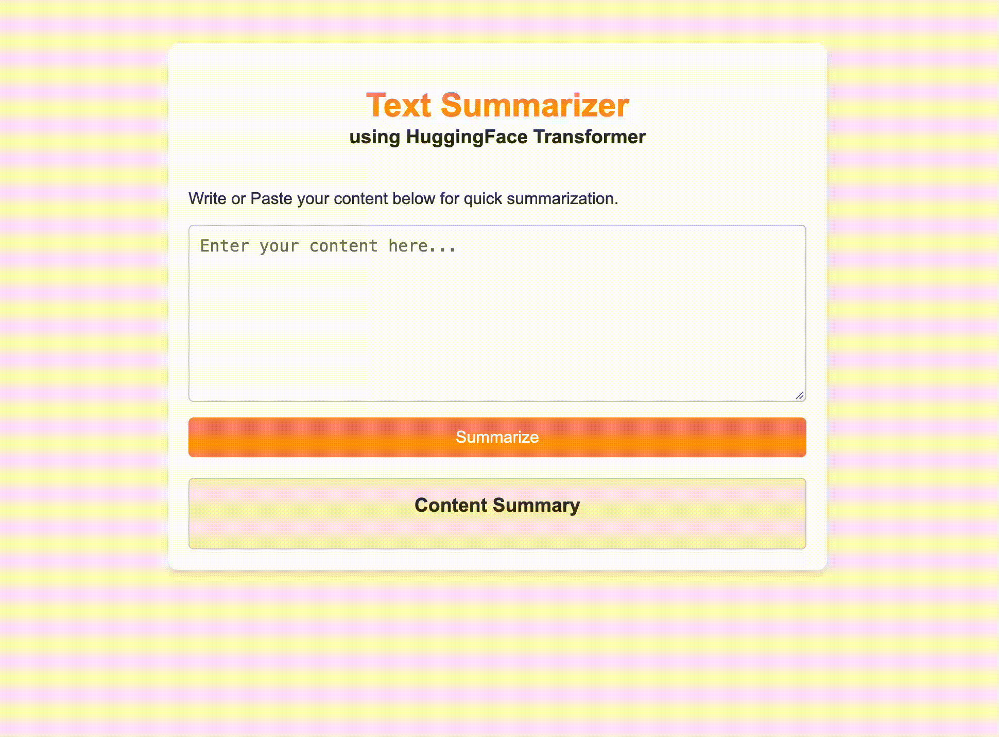

# TextSummarizerApp

An end-to-end Natural Language Processing (NLP) web application that generates concise, coherent summaries from long-form text using deep learning transformer models.

---

## Demo

<p align="center">
  
</p>

## Features

* **Abstractive Text Summarisation:** Condenses lengthy articles, reports, and documents into clear, human-like summaries while preserving core context.
* **Interactive Web Interface:** Clean, responsive UI allowing users to paste text, adjust summary length parameters, and view results in real time.
* **Dual Deployment Ready:** Configured for seamless version control on GitHub and live model hosting on Hugging Face Spaces (with Git LFS support for model weights).

---

## Tech Stack

* **Language:** Python 3.11+
* **Deep Learning & NLP:** PyTorch, Hugging Face `transformers`
* **Web Framework:** Gradio / Streamlit *(update to match your UI framework)*
* **Version Control & Storage:** Git, Git LFS, Hugging Face Hub

---

## Project Structure

```text
TextSummarizerApp/
├── app.py                  # Main application entry point & UI
├── model/                  # Model weights / LFS tracked artifacts
├── requirements.txt        # Python dependencies
├── README.md               # Project documentation
└── .gitignore              # Ignored environment & cache files
```
---


## Local Setup & Installation

Follow these steps to set up and run the application locally on your machine:

1. **Clone the repository:**
   ```bash
   git clone [https://github.com/Thamina33/TextSummarizerApp.git](https://github.com/Thamina33/TextSummarizerApp.git)
   cd TextSummarizerApp

2. **Pull Git LFS files (for model weights):**
   ```bash
   git lfs install
   git lfs pull

3. **Create and activate a virtual environment:**
   ```bash
   conda create -n summarizer python=3.11 -y
   conda activate summarizer

4. **Install dependencies:**
   ```bash
   pip install -r requirements.txt

5. **Run the application:**
   ```bash
   python app.py

## Author

**Thamina Omar Toma**  
* GitHub: [@Thamina33](https://github.com/Thamina33)